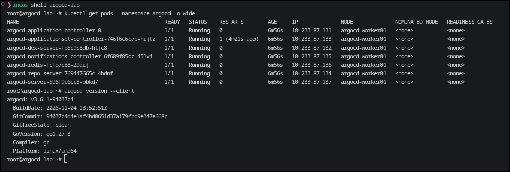
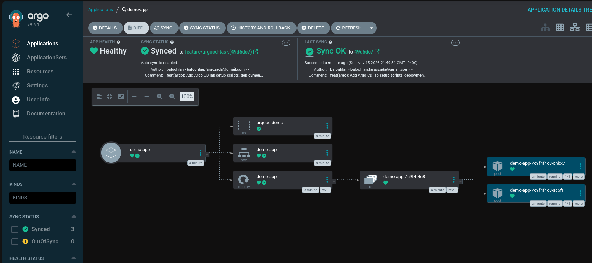
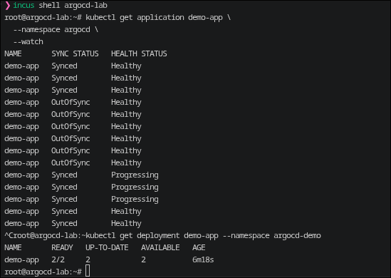
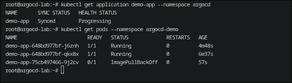
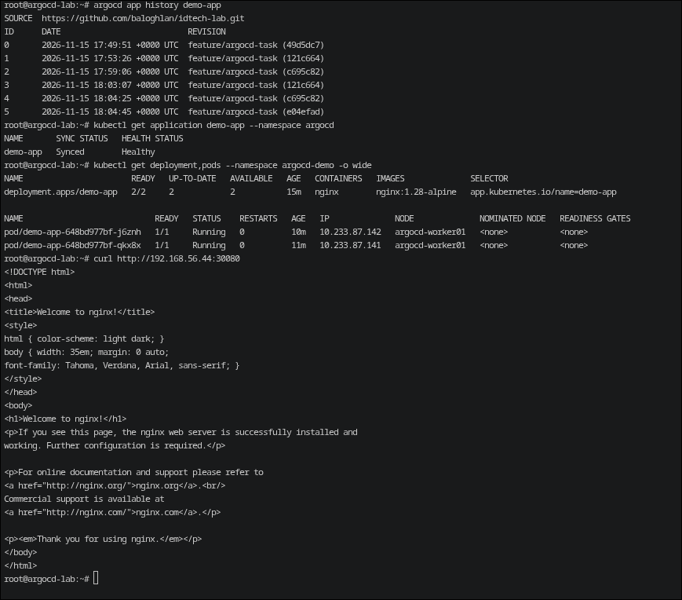

# IDTECH Argo CD Lab

This lab demonstrates how to provision a Kubernetes cluster with Kubespray on Incus virtual machines, install Argo CD from its official manifests, and manage a sample application using GitOps principles.

The complete environment is prepared through a single `setup-environment.sh` script. It creates the required virtual machines, configures SSH connectivity, deploys Kubernetes, prepares the management VM, and installs Argo CD.

## Objectives

- Provision a Kubernetes cluster with Kubespray
- Install the Argo CD server and CLI
- Manage Kubernetes manifests from a Git repository
- Enable automatic sync, pruning, and self-healing
- Verify that an image update committed to Git is deployed automatically
- Introduce a faulty image and restore the stable application version

## Architecture

```text
Host machine
  |
  | Incus
  |
  +-- argocd-lab        192.168.56.42  Management node
  |     - Kubespray / Ansible
  |     - kubectl
  |     - Argo CD CLI
  |
  +-- argocd-control01  192.168.56.43  Control plane + etcd
  |
  +-- argocd-worker01   192.168.56.44  Worker node
        - Argo CD workloads
        - demo-app workloads
```

| Component | Version / selection |
|---|---|
| Operating system | Ubuntu 22.04 LTS |
| Kubespray | v2.28.1 |
| Kubernetes | v1.32.8 |
| Container runtime | containerd 2.0.6 |
| CNI | Calico |
| Argo CD | v3.6.1 |
| Demo application | nginx:1.28-alpine |

## Repository structure

```text
idtech-argocd-lab/
├── app/
│   ├── deployment.yaml
│   ├── namespace.yaml
│   └── service.yaml
├── argocd/
│   └── application.yaml
├── kubespray/
│   └── inventory.ini
├── screenshots/
│   ├── 01.argocd-installation.png
│   ├── 02.application-synced.png
│   ├── 03.automatic-sync.png
│   ├── 04.faulty-deployment.png
│   └── 05.successful-rollback.png
├── scripts/
│   ├── lib/
│   │   └── common.sh
│   ├── remote/
│   │   ├── configure-management.sh
│   │   ├── install-argocd.sh
│   │   └── install-kubespray.sh
│   └── steps/
│       ├── 01-provision-vms.sh
│       ├── 02-configure-ssh.sh
│       ├── 03-install-kubespray.sh
│       ├── 04-deploy-kubernetes.sh
│       ├── 05-configure-management.sh
│       └── 06-install-argocd.sh
└── setup-environment.sh
```

Key files and directories:

- `setup-environment.sh` is the main entry point that runs all setup steps in order.
- `kubespray/inventory.ini` defines the control plane, etcd, and worker groups.
- `app/` contains the Namespace, Deployment, and Service manifests for the demo application.
- `argocd/application.yaml` defines the Git source, destination, and synchronization policy.
- `scripts/steps/` contains the modular steps executed from the host machine.
- `scripts/remote/` contains scripts executed inside the `argocd-lab` VM.

## Prerequisites

The host machine must provide:

- A Linux host with KVM available at `/dev/kvm`
- Incus and a running Incus daemon
- An Incus network named `incusbr0`
- An Incus storage pool named `default`
- Access to the Ubuntu 22.04 image
- Internet access to GitHub and container registries
- Approximately 8 vCPUs, 13 GiB of RAM, and 95 GiB of disk capacity

Verify the local environment before starting:

```bash
incus info
incus network show incusbr0
incus storage show default
test -e /dev/kvm && echo "KVM is available"
```

## One-command environment setup

Run the following commands from the project directory on the host machine:

```bash
cd idtech-argocd-lab
chmod +x setup-environment.sh
./setup-environment.sh
```

The script automatically:

1. Validates the host requirements.
2. Creates `argocd-lab`, `argocd-control01`, and `argocd-worker01`.
3. Configures the static IP addresses and VM resources.
4. Establishes passwordless root SSH access from the management VM to the Kubernetes nodes.
5. Installs Kubespray v2.28.1 and its Python virtual environment.
6. Copies the inventory and validates Ansible connectivity.
7. Runs the Kubespray `cluster.yml` playbook.
8. Copies `kubectl` and the admin kubeconfig to `argocd-lab`.
9. Installs Argo CD v3.6.1 and its CLI.
10. Displays the final Kubernetes and Argo CD status.

If a Kubespray download fails, the playbook is retried up to three times. The installation log is stored at `/root/kubespray-cluster.log` on the management VM.

The script can be run again. If both Kubernetes nodes are already `Ready`, the Kubespray deployment step is skipped.

## Verifying the Kubernetes cluster

Enter the management VM:

```bash
incus shell argocd-lab
```

Verify the nodes and system pods:

```bash
kubectl get nodes -o wide
kubectl get pods --all-namespaces
```

Expected nodes:

```text
argocd-control01   Ready   control-plane
argocd-worker01    Ready   <none>
```

To validate Ansible connectivity separately, run the following inside `argocd-lab`:

```bash
source /opt/kubespray-venv/bin/activate
cd /opt/kubespray
ansible -i inventory/argocd-cluster/inventory.ini all -m ping
```

Both hosts should return `SUCCESS` and `pong`.

## Verifying Argo CD

Run these commands on the management VM:

```bash
kubectl get pods --namespace argocd -o wide
argocd version --client
```

The official Argo CD manifest is installed with server-side apply. This avoids the `metadata.annotations: Too long` error that can occur when large CRDs are installed with client-side apply.



## Accessing the Argo CD UI

Start port forwarding in a separate terminal on the host machine:

```bash
incus exec argocd-lab -- kubectl port-forward \
  --address 0.0.0.0 \
  --namespace argocd \
  service/argocd-server 8080:443
```

Open the following address:

```text
https://192.168.56.42:8080
```

Argo CD uses a self-signed certificate in this lab, so the browser may display a certificate warning.

The username is `admin`. Retrieve the initial password from the host:

```bash
incus exec argocd-lab -- bash -lc \
  "kubectl get secret argocd-initial-admin-secret \
  --namespace argocd \
  --output jsonpath='{.data.password}' | base64 --decode; echo"
```

## Registering the demo application

The `argocd/application.yaml` manifest uses this configuration:

| Parameter | Value |
|---|---|
| Repository | `https://github.com/baloghlan/idtech-lab.git` |
| Revision | `feature/argocd-task` |
| Manifest path | `idtech-argocd-lab/app` |
| Destination cluster | `https://kubernetes.default.svc` |
| Namespace | `argocd-demo` |
| Automatic sync | Enabled |
| Prune | Enabled |
| Self-heal | Enabled |

From the project directory on the host, copy and apply the Application manifest:

```bash
incus file push \
  argocd/application.yaml \
  argocd-lab/root/application.yaml

incus exec argocd-lab -- \
  kubectl apply --filename /root/application.yaml
```

Inspect the result from the management VM:

```bash
incus shell argocd-lab
kubectl get application demo-app --namespace argocd
kubectl get all --namespace argocd-demo
```

After the initial synchronization, the application should be `Synced` and `Healthy`, and both demo pods should be `Running`.



## Accessing the demo application

The Service uses the `NodePort` type and exposes port `30080` on the worker:

```bash
curl http://192.168.56.44:30080
```

The command should return the nginx welcome page.

## Automatic synchronization

When the image in `app/deployment.yaml` is changed and pushed to the tracked branch, Argo CD detects the commit and updates the cluster without another manual `kubectl apply`.

The stable image used in this lab is:

```yaml
image: nginx:1.28-alpine
```

Watch the sync process:

```bash
kubectl get application demo-app \
  --namespace argocd \
  --watch
```

Verify the Deployment and applied image:

```bash
kubectl get deployment demo-app \
  --namespace argocd-demo \
  --output wide

kubectl get deployment demo-app \
  --namespace argocd-demo \
  --output jsonpath='{.spec.template.spec.containers[0].image}{"\n"}'
```

Argo CD detects the new revision, synchronizes the resources, and returns the application to `Healthy` after the rollout completes.



## Faulty deployment

To test recovery, the Deployment was changed to use a nonexistent image tag and the change was pushed to Git. Argo CD synchronized the revision, but the new pod could not pull the image and entered `ImagePullBackOff`.

Inspect the failure:

```bash
kubectl get application demo-app --namespace argocd
kubectl get pods --namespace argocd-demo
kubectl describe pod --namespace argocd-demo <FAULTY_POD_NAME>
```

The rolling update strategy uses `maxUnavailable: 0`. Existing healthy pods therefore remain available while the faulty replacement pod is created, preventing a complete outage.



## Rollback and recovery

Git is the source of truth in this workflow. A permanent rollback requires reverting the faulty commit and pushing the revert:

```bash
git revert <FAULTY_COMMIT_SHA>
git push origin feature/argocd-task
```

Argo CD detects the revert, restores `nginx:1.28-alpine`, and returns the application to `Synced` and `Healthy`.

Verify the history and final state:

```bash
argocd app history demo-app
kubectl get application demo-app --namespace argocd
kubectl get deployment,pods --namespace argocd-demo -o wide
curl http://192.168.56.44:30080
```

The lab produced this commit sequence:

| Commit | Purpose |
|---|---|
| `49d5dc7` | Initial Argo CD lab and demo application |
| `121c664` | Update the demo application image |
| `c695c82` | Deploy a nonexistent image and introduce a failure |
| `e04efad` | Revert the faulty commit and restore the stable version |



## Useful diagnostic commands

Run these commands inside `argocd-lab`:

```bash
# Kubernetes nodes
kubectl get nodes -o wide

# Argo CD components
kubectl get pods --namespace argocd -o wide

# Application status
kubectl get application demo-app --namespace argocd -o wide

# Resources managed by Argo CD
kubectl get all --namespace argocd-demo

# Deployment rollout status
kubectl rollout status deployment/demo-app --namespace argocd-demo

# Application events
kubectl describe application demo-app --namespace argocd

# Argo CD history
argocd app history demo-app

# Kubespray installation log
tail -n 100 /root/kubespray-cluster.log
```

## Screenshot evidence

| No. | File | Evidence |
|---|---|---|
| 1 | [01.argocd-installation.png](screenshots/01.argocd-installation.png) | Argo CD pods are running and the CLI is installed |
| 2 | [02.application-synced.png](screenshots/02.application-synced.png) | The initial application is `Synced` and `Healthy` |
| 3 | [03.automatic-sync.png](screenshots/03.automatic-sync.png) | The Git change was synchronized automatically and both replicas are ready |
| 4 | [04.faulty-deployment.png](screenshots/04.faulty-deployment.png) | The invalid image caused the new pod to enter `ImagePullBackOff` |
| 5 | [05.successful-rollback.png](screenshots/05.successful-rollback.png) | The stable image, healthy pods, and endpoint were verified after the revert |

## Security and lab considerations

- This topology is intended for a lab. It has one control plane node and is not highly available.
- SSH access uses root inside the lab. Production environments should use restricted accounts and secure key management.
- `/root/.kube/config` grants cluster-admin privileges and must be protected.
- The initial Argo CD administrator password should be changed after the first login, and the initial secret should be removed.
- The UI uses a self-signed certificate and port forwarding. Production environments should use Ingress, trusted TLS, and SSO.
- The demo application uses NodePort for convenient testing. Production environments should use Ingress or a suitable LoadBalancer.
- The `Application` currently tracks `feature/argocd-task`. After merge, `targetRevision` can be changed to `main`.

## Result

The lab produced a two-node Kubernetes cluster deployed with Kubespray, an operational Argo CD installation, and a demo nginx application managed from Git. An image update was deployed automatically, an intentionally faulty deployment was observed, and the stable application state was successfully restored through a Git revert.
