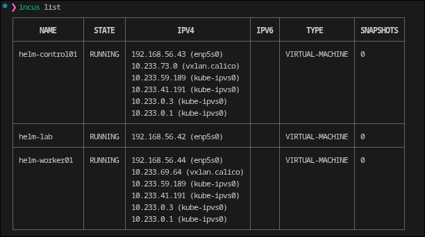
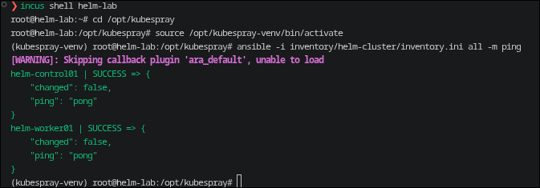
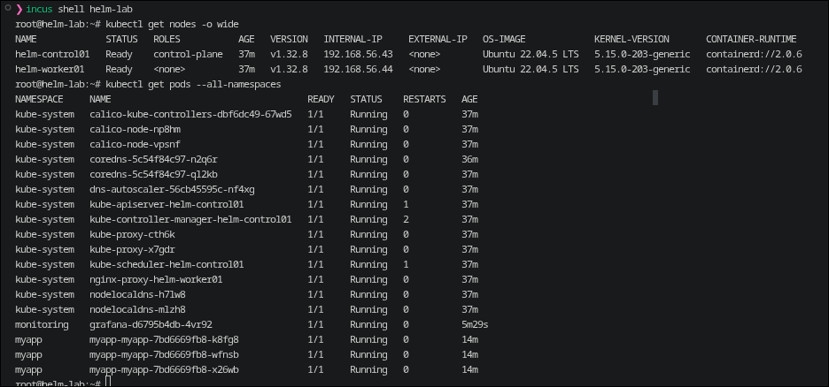
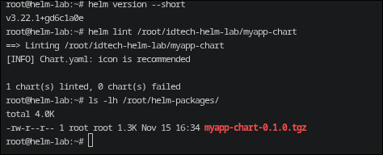
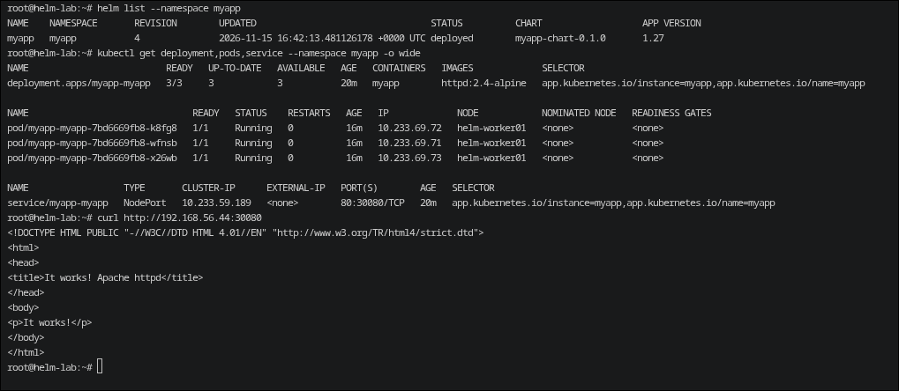
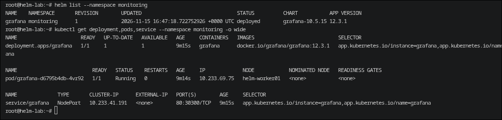

# IDTECH Helm Lab

This project demonstrates a complete Helm workflow on a Kubernetes cluster provisioned with Kubespray. The lab starts with Incus virtual machines, builds a two-node Kubernetes cluster, creates and packages a custom Helm chart, tests values overrides and rollback, and installs Grafana from its official Helm repository.

## Lab objectives

- Provision Ubuntu virtual machines with Incus.
- Deploy Kubernetes with Kubespray instead of a lightweight Kubernetes distribution.
- Configure `helm-lab` as the Ansible, `kubectl`, and Helm management node.
- Create and package the `myapp-chart` application chart.
- Install the chart and expose it through a NodePort Service.
- Override replica and image values during an upgrade.
- Simulate a broken release and restore a working Helm revision.
- Fetch, extract, customize, and install the official Grafana chart.

## Architecture

```text
                            Incus host
                                |
                       incusbr0: 192.168.56.0/24
                                |
          +---------------------+---------------------+
          |                     |                     |
          v                     v                     v
   +--------------+     +----------------+     +---------------+
   |   helm-lab   |     | helm-control01 |     | helm-worker01 |
   | 192.168.56.42|     | 192.168.56.43  |     | 192.168.56.44 |
   |              |     |                |     |               |
   | Kubespray    |---->| control-plane  |-----| worker        |
   | Ansible      | SSH | etcd           |     | application   |
   | kubectl/Helm |     | API server     |     | workloads     |
   +--------------+     +----------------+     +---------------+
                                                     |
                                      +--------------+-------------+
                                      |                            |
                                MyApp :30080                Grafana :30300
```

| VM | IP address | Resources | Purpose |
|---|---|---|---|
| `helm-lab` | `192.168.56.42` | 2 CPU, 2 GiB RAM, 25 GiB disk | Kubespray, Ansible, `kubectl`, and Helm management node |
| `helm-control01` | `192.168.56.43` | 2 CPU, 3 GiB RAM, 30 GiB disk | Kubernetes control plane and single-member etcd |
| `helm-worker01` | `192.168.56.44` | 2 CPU, 6 GiB RAM, 40 GiB disk | Application and Grafana workloads |

The cluster is intentionally not highly available. A single control-plane and etcd node are sufficient for this isolated training environment.

## Software versions

| Component | Version |
|---|---|
| Ubuntu | 22.04.5 LTS |
| Kubespray | `v2.28.1` |
| Ansible Core | `2.16.20` |
| Kubernetes | `v1.32.8` |
| containerd | `2.0.6` |
| Helm | `v3.22.1` |
| Kubernetes network plugin | Calico |
| Grafana chart | `10.5.15` |
| Grafana application | `12.3.1` |

## Repository structure

```text
idtech-helm-lab/
├── grafana/
│   └── values-lab.yaml
├── kubespray/
│   └── inventory.ini
├── myapp-chart/
│   ├── templates/
│   │   ├── _helpers.tpl
│   │   ├── deployment.yaml
│   │   └── service.yaml
│   ├── .helmignore
│   ├── Chart.yaml
│   ├── values.yaml
│   ├── values-override.yaml
│   └── values-broken.yaml
├── screenshots/
├── scripts/
│   ├── configure-ssh.sh
│   ├── deploy-kubernetes.sh
│   ├── init-vms.sh
│   └── install-kubespray.sh
└── README.md
```

## Prerequisites

The host machine requires:

- Incus with a working `default` storage pool.
- The `incusbr0` managed network using `192.168.56.0/24`.
- KVM virtualization through `/dev/kvm`.
- Internet access for Ubuntu packages, Kubernetes artifacts, container images, and Helm repositories.

All host-side commands below are run from `idtech-helm-lab/` unless stated otherwise.

## 1. Provision the virtual machines

Create and start the three virtual machines:

```bash
./scripts/init-vms.sh
```

Verify their addresses and state:

```bash
incus list
```



## 2. Configure SSH access

Kubespray runs on `helm-lab` and connects to the cluster nodes through SSH. The configuration script installs OpenSSH and Python on the target nodes, creates an Ed25519 key on `helm-lab`, distributes its public key, and tests passwordless access.

```bash
./scripts/configure-ssh.sh
```

Manual verification:

```bash
incus shell helm-lab
ssh root@192.168.56.43 hostname
ssh root@192.168.56.44 hostname
```

The commands must return `helm-control01` and `helm-worker01` without requesting a password.

## 3. Install Kubespray

Copy the installation script to the management VM and execute it there:

```bash
incus file push scripts/install-kubespray.sh \
  helm-lab/root/install-kubespray.sh

incus exec helm-lab -- chmod +x /root/install-kubespray.sh
incus exec helm-lab -- /root/install-kubespray.sh
```

The script installs the required system packages, clones Kubespray `v2.28.1` into `/opt/kubespray`, and creates the Python virtual environment at `/opt/kubespray-venv`.

The cluster layout is defined in [kubespray/inventory.ini](kubespray/inventory.ini):

```ini
[kube_control_plane]
helm-control01

[etcd]
helm-control01

[kube_node]
helm-worker01
```

Test Ansible connectivity from `helm-lab`:

```bash
incus shell helm-lab
cd /opt/kubespray
source /opt/kubespray-venv/bin/activate
ansible -i inventory/helm-cluster/inventory.ini all -m ping
```

Both hosts must return `SUCCESS` and `pong`. The optional `ara_default` callback warning does not affect deployment.



## 4. Deploy Kubernetes

Run the deployment script on the Incus host:

```bash
./scripts/deploy-kubernetes.sh
```

The script performs the following operations:

1. Verifies that `helm-lab` and the Kubespray virtual environment are available.
2. Copies the repository inventory to `/opt/kubespray/inventory/helm-cluster/inventory.ini`.
3. Validates the inventory and runs the Ansible ping test.
4. Executes Kubespray's `cluster.yml` playbook.
5. Saves the deployment output in `/root/kubespray-cluster.log` on `helm-lab`.

After deployment, copy `kubectl` and the administrative kubeconfig from the control-plane node to `helm-lab`:

```bash
incus shell helm-lab

scp root@192.168.56.43:/usr/local/bin/kubectl /usr/local/bin/kubectl
chmod 755 /usr/local/bin/kubectl

install -d -m 700 /root/.kube
scp root@192.168.56.43:/etc/kubernetes/admin.conf /root/.kube/config
chmod 600 /root/.kube/config

sed -i \
  's#server: .*#server: https://192.168.56.43:6443#' \
  /root/.kube/config
```

Verify cluster health:

```bash
kubectl get nodes -o wide
kubectl get pods --all-namespaces
```

Both nodes must be `Ready`, and the Calico, CoreDNS, control-plane, and node-local DNS pods must be `Running`.



## 5. Install Helm on the management VM

Run on `helm-lab`:

```bash
curl -fsSL \
  https://raw.githubusercontent.com/helm/helm/main/scripts/get-helm-3 \
  -o /tmp/get-helm.sh

chmod 700 /tmp/get-helm.sh
/tmp/get-helm.sh
```

Verify Kubernetes and Helm access:

```bash
kubectl get nodes
helm version --short
helm list --all-namespaces
```

## 6. Custom application chart

The `myapp-chart` chart contains:

- A configurable application name.
- A configurable replica count.
- A configurable container repository, tag, and pull policy.
- A Deployment template.
- A NodePort Service template.
- Release-specific resource names and standard Helm labels.

Default values in [myapp-chart/values.yaml](myapp-chart/values.yaml):

```yaml
application:
  name: myapp

replicaCount: 2

image:
  repository: nginx
  tag: "1.27-alpine"
  pullPolicy: IfNotPresent

service:
  type: NodePort
  port: 80
  targetPort: 80
  nodePort: 30080
```

Copy the chart from the host to `helm-lab`:

```bash
incus exec helm-lab -- mkdir -p /root/idtech-helm-lab

incus file push --recursive \
  myapp-chart \
  helm-lab/root/idtech-helm-lab/
```

Validate and package it on `helm-lab`:

```bash
helm lint /root/idtech-helm-lab/myapp-chart

helm template myapp \
  /root/idtech-helm-lab/myapp-chart \
  --namespace myapp

mkdir -p /root/helm-packages

helm package \
  /root/idtech-helm-lab/myapp-chart \
  --destination /root/helm-packages
```



Install the packaged chart:

```bash
helm install myapp \
  /root/helm-packages/myapp-chart-0.1.0.tgz \
  --namespace myapp \
  --create-namespace \
  --wait \
  --timeout 5m
```

Verify the release and endpoint:

```bash
helm list --namespace myapp
kubectl get deployment,pods,service --namespace myapp -o wide
curl http://192.168.56.44:30080
```

## 7. Values override and upgrade

[myapp-chart/values-override.yaml](myapp-chart/values-override.yaml) changes the replica count from two to three and replaces Nginx with Apache HTTP Server:

```yaml
replicaCount: 3

image:
  repository: httpd
  tag: "2.4-alpine"
  pullPolicy: IfNotPresent
```

Copy the override file to `helm-lab`, then upgrade the release:

```bash
incus file push \
  myapp-chart/values-override.yaml \
  helm-lab/root/idtech-helm-lab/myapp-chart/values-override.yaml
```

Run on `helm-lab`:

```bash
helm upgrade myapp \
  /root/helm-packages/myapp-chart-0.1.0.tgz \
  --namespace myapp \
  --values /root/idtech-helm-lab/myapp-chart/values-override.yaml \
  --wait \
  --timeout 5m

kubectl rollout status deployment/myapp-myapp \
  --namespace myapp \
  --timeout 180s

curl http://192.168.56.44:30080
```

The expected response contains Apache's `It works!` page.



## 8. Failed upgrade and rollback

[myapp-chart/values-broken.yaml](myapp-chart/values-broken.yaml) intentionally references a nonexistent image tag. It is used only to demonstrate Helm revision history and rollback.

```bash
helm upgrade myapp \
  /root/helm-packages/myapp-chart-0.1.0.tgz \
  --namespace myapp \
  --values /root/idtech-helm-lab/myapp-chart/values-broken.yaml

kubectl get pods --namespace myapp
helm history myapp --namespace myapp
```

The new pod enters `ErrImagePull` or `ImagePullBackOff`. Restore the last known working release, revision 2 in this run:

```bash
helm rollback myapp 2 \
  --namespace myapp \
  --wait \
  --timeout 5m
```

Helm records rollback as a new revision. Verify that the active deployment is again using three replicas and `httpd:2.4-alpine`:

```bash
helm history myapp --namespace myapp

kubectl get deployment myapp-myapp \
  --namespace myapp \
  -o jsonpath='{.spec.replicas}{" replicas\n"}{.spec.template.spec.containers[0].image}{"\n"}'
```

Do not assume that revision 2 is always the desired rollback target in another environment. Inspect `helm history` before choosing the revision.

## 9. Grafana installation

Add and update the official Grafana Helm repository on `helm-lab`:

```bash
helm repo add grafana https://grafana.github.io/helm-charts
helm repo update
```

Fetch and extract the pinned chart:

```bash
mkdir -p /root/idtech-helm-lab/grafana

helm pull grafana/grafana \
  --version 10.5.15 \
  --untar \
  --untardir /root/idtech-helm-lab/grafana
```

The custom [grafana/values-lab.yaml](grafana/values-lab.yaml) configuration:

- Exposes Grafana through NodePort `30300`.
- Configures CPU and memory requests and limits.
- Disables the chart test framework.
- Disables persistence because this lab has no default StorageClass.

Copy the values file from the host:

```bash
incus file push \
  grafana/values-lab.yaml \
  helm-lab/root/idtech-helm-lab/grafana/values-lab.yaml
```

Validate the extracted chart:

```bash
helm lint /root/idtech-helm-lab/grafana/grafana \
  --values /root/idtech-helm-lab/grafana/values-lab.yaml
```

Generate the admin password in memory and install Grafana:

```bash
GRAFANA_ADMIN_PASSWORD="$(openssl rand -base64 24 | tr -d '\n')"

helm install grafana \
  /root/idtech-helm-lab/grafana/grafana \
  --namespace monitoring \
  --create-namespace \
  --values /root/idtech-helm-lab/grafana/values-lab.yaml \
  --set-string adminPassword="$GRAFANA_ADMIN_PASSWORD" \
  --wait \
  --timeout 10m

unset GRAFANA_ADMIN_PASSWORD
```

Verify the release:

```bash
helm list --namespace monitoring
kubectl get deployment,pods,service --namespace monitoring -o wide
curl -I http://192.168.56.44:30300/login
```



Grafana is available at:

```text
http://192.168.56.44:30300
```

The username is `admin`. Retrieve the generated password without storing it in Git:

```bash
kubectl get secret grafana \
  --namespace monitoring \
  --output jsonpath='{.data.admin-password}' | base64 --decode
echo
```

## Operational checks

Run these commands from `helm-lab`:

```bash
kubectl get nodes -o wide
kubectl get pods --all-namespaces
helm list --all-namespaces
helm history myapp --namespace myapp
kubectl get service --all-namespaces
```

Application endpoints:

| Application | Address |
|---|---|
| MyApp | `http://192.168.56.44:30080` |
| Grafana | `http://192.168.56.44:30300` |

## Evidence

| Screenshot | Demonstrates |
|---|---|
| [Virtual machines](screenshots/01.virtual-machines.png) | Three running Incus VMs and their addresses |
| [Ansible connectivity](screenshots/02.ansible-connectivity.png) | Successful Kubespray SSH and Python connectivity |
| [Kubernetes cluster](screenshots/03.kubernetes-cluster.png) | Ready nodes and running system/application pods |
| [Helm chart validation](screenshots/04.helm-chart-validation.png) | Helm version, successful lint, and packaged chart |
| [MyApp deployment](screenshots/05.myapp-initial-deployment.png) | Deployed release, three Apache replicas, NodePort, and HTTP response |
| [Grafana deployment](screenshots/06.grafana-helm-deployment.png) | Deployed Grafana release, pod, and NodePort Service |

## Security and lab limitations

- The kubeconfig copied to `helm-lab` grants cluster-admin access and is protected with mode `0600`.
- SSH uses the `root` account for simplicity. Production environments should use a dedicated automation user with controlled privilege escalation.
- The control plane and etcd are not highly available.
- MyApp and Grafana use NodePort Services and are not protected by TLS or authentication at the network edge.
- Grafana persistence is disabled. Dashboards and other local Grafana data are lost if its pod is recreated.
- Grafana's admin password, SSH private keys, kubeconfig credentials, and Kubernetes Secrets must never be committed to this repository.
- The intentionally broken image tag exists only to demonstrate rollback and must not remain active.

This setup is intended for an isolated local training environment, not production use.
